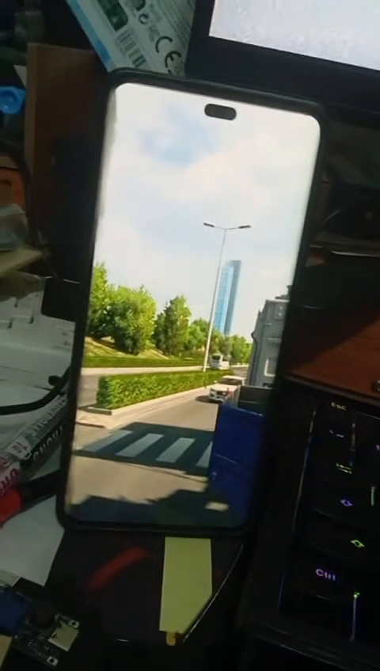
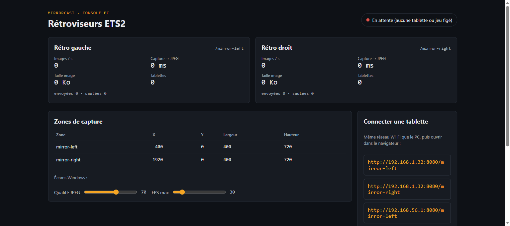
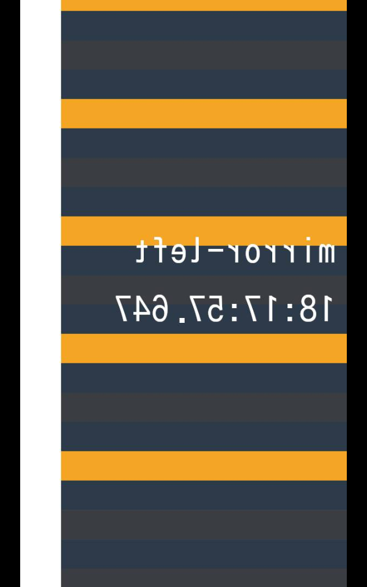

# 🚛 MirrorCast ETS2

### Les rétroviseurs d'Euro Truck Simulator 2 sur vos tablettes.

*Posez une tablette de chaque côté de votre écran : elles affichent en direct ce que voient les rétroviseurs de votre camion, remorque comprise, en Wi‑Fi et sans rien installer dessus.*

 

 

<i>En jeu : en haut le rétroviseur dans ETS2, en bas le téléphone qui sert de rétro, remorque comprise.</i>

  

[**Pourquoi**](#-pourquoi-mirrorcast-) · [**Fonctionnalités**](#-fonctionnalités) · [**En images**](#%EF%B8%8F-en-images) · [**Télécharger**](#%EF%B8%8F-télécharger) · [**Questions fréquentes**](#-questions-fréquentes)

 

---

## 💡 Pourquoi MirrorCast ?

Dans ETS2, les rétroviseurs sont petits, coincés dans un coin de l'écran, et il faut tourner
la tête virtuelle pour bien voir la remorque. Dans un vrai camion, ils sont **sur les côtés**.

**MirrorCast remet les rétros à leur place.** Une tablette (ou un vieux téléphone) à gauche, une
autre à droite : chacune affiche en continu la vue arrière de son côté. Votre écran garde la
vue cabine, sans rien qui la gêne.

 

## ✨ Fonctionnalités

<table>
<tr>
<td width="50%" valign="top">

### 🪞 De vrais rétroviseurs
- **Vue arrière gauche et droite**, avec la **remorque visible**.
- Image **inversée comme dans un miroir**.
- Angles des rétros **réglables** (direction, zoom, position).
- Environ **24 images par seconde** en jeu, avec une latence d'environ **25 ms** sur la mire.

</td>
<td width="50%" valign="top">

### 📱 Rien à installer sur les tablettes
- Une **simple page web** : Chrome ou Safari suffisent.
- Fonctionne avec de **vieilles tablettes** (testé sur Android 7).
- **Reconnexion automatique** en cas de coupure Wi‑Fi.
- Plein écran, ajustement de l'image, inversion d'un toucher.

</td>
</tr>
<tr>
<td width="50%" valign="top">

### 🧩 Tout-en-un
- **Un double-clic** sur `MirrorCast.exe` :
- il **règle ETS2** (mode multi-écran, vues des rétros, fenêtre) ;
- il **lance le jeu** via Steam et **place sa fenêtre** ;
- il ouvre une **console** avec les adresses à taper sur les tablettes.

</td>
<td width="50%" valign="top">

### 🎮 Respecte le jeu et le PC
- **Rien n'est injecté** dans ETS2 : aucun mod, aucun risque pour vos sauvegardes.
- Votre écran n'est **jamais lu** : seules les vues des rétros sont capturées.
- **Aucune capture** tant qu'aucune tablette n'est connectée.
- **« Tout annuler »** remet ETS2 et Windows comme avant.

</td>
</tr>
</table>

 

## 🖼️ En images

<table>
<tr>
<td width="50%" align="center">
 
<b>Le rétro sur le téléphone</b> La remorque, comme dans le rétroviseur du jeu.
</td>
<td width="50%" align="center">
 
<b>En ville</b> La vue arrière en continu, posée à côté de l'écran.
</td>
</tr>
<tr>
<td width="50%" align="center">
 
<b>La console du PC</b> Images par seconde, adresses des tablettes, qualité réglable à chaud.
</td>
<td width="50%" align="center">
 
<b>La mire de test</b> Pour vérifier les tablettes et le Wi‑Fi sans lancer le jeu.
</td>
</tr>
</table>

 

## ⬇️ Télécharger

### [**➜ Page de téléchargement (dernière version)**](https://github.com/lerapeurdu62280-debug/MirrorCast-ETS2-Download/releases/latest)

| Fichier | Contenu |
|---|---|
| **`MirrorCast-ETS2-v0.2.0.zip`** | Version portable : décompressez-la où vous voulez, il n'y a rien à installer. |

> **Windows affiche « Windows a protégé votre ordinateur » ?** C'est normal pour un logiciel récent. Cliquez sur **Informations complémentaires**, puis sur **Exécuter quand même**.

### 🖥️ Configuration requise
- **Windows 10 ou 11**, 64 bits, et **Euro Truck Simulator 2** sur Steam.
- Une carte graphique de jeu (testé avec une **RTX 3050**).
- Une ou deux **tablettes ou téléphones** avec un navigateur, sur le **même réseau Wi‑Fi** que le PC (5 GHz conseillé).
- Le pilote gratuit **[Virtual Display Driver](https://github.com/VirtualDrivers/Virtual-Display-Driver/releases)**, qui crée les deux écrans invisibles où le jeu dessine les rétros.

 

## 🚀 En trois gestes

1. **Une seule fois :** installez Virtual Display Driver et créez **deux écrans de 400×720**, collés à gauche et à droite de votre écran dans *Paramètres → Affichage*. Le fichier `LISEZMOI.txt` vous guide.
2. **Double-cliquez sur `MirrorCast.exe`.** Au premier lancement, autorisez-le dans le pare-feu Windows. ETS2 se lance tout seul.
3. **Sur chaque tablette**, ouvrez l'adresse affichée dans la console, par exemple `http://192.168.1.20:8080/mirror-left`. C'est prêt.

 

## 🧭 Où en est le projet ?

| Étape | État |
|---|---|
| Rétros en jeu sur tablettes, remorque visible, ~24 i/s | ✅ Testé en conditions réelles |
| Mire de test, console du PC | ✅ Testés |
| Mode tout-en-un de la version 0.2.0 (réglage et lancement automatiques d'ETS2) | 🧪 En cours de test |

 

## ❓ Questions fréquentes

<b>Est-ce que ça modifie le jeu ou mes sauvegardes ?</b>

 
Non. MirrorCast n'installe aucun mod et ne touche pas à vos profils. Il règle seulement l'affichage d'ETS2 (mode multi-écran et vues des rétros), après avoir sauvegardé vos fichiers de configuration. « Tout annuler » les remet tels qu'ils étaient.

<b>Pourquoi faut-il des écrans virtuels ?</b>

 
ETS2 sait dessiner plusieurs vues à la fois, mais seulement sur des écrans. Les écrans virtuels sont invisibles et branchés à rien : le jeu y dessine les rétros, et MirrorCast les envoie aux tablettes. Votre écran à vous ne change pas.

<b>Les rétros se figent quand je reviens dans le jeu.</b>

 
Quittez ETS2 et relancez-le : le réglage anti-gel appliqué par MirrorCast n'est pris en compte qu'au démarrage du jeu. La console vous prévient si cela arrive.

<b>La tablette ne se connecte pas.</b>

 
Vérifiez que le PC et la tablette sont sur le même réseau, et que MirrorCast est autorisé dans le pare-feu Windows (réseau privé). Avec un VPN sur le PC, activez l'option de visibilité du réseau local. La mire de test permet de vérifier tout cela sans lancer le jeu.

<b>Ça marche avec American Truck Simulator ?</b>

 
Pas encore : cette version ne gère qu'Euro Truck Simulator 2.

 

---

💬 Une question, un souci ? Rejoignez le **[Discord de l'atelier](https://discord.gg/W5hd36CW6b)**.

**MirrorCast ETS2** — conçu et développé par **S.O.S INFO LUDO**

Logiciel propriétaire, tous droits réservés. Euro Truck Simulator 2 est une marque de SCS Software. Ce logiciel est indépendant : il n'est ni affilié à SCS Software, ni approuvé par SCS Software.

