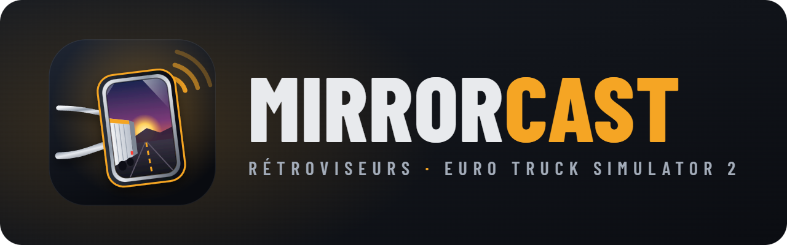
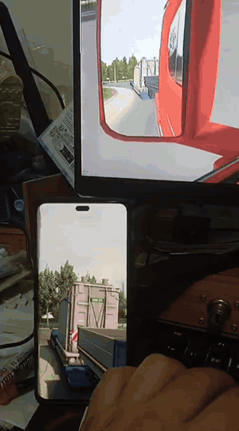
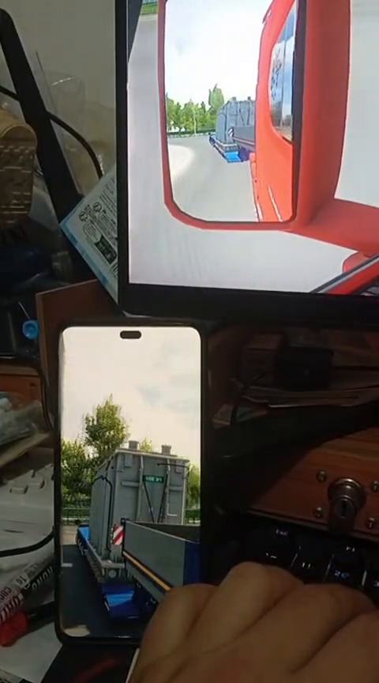
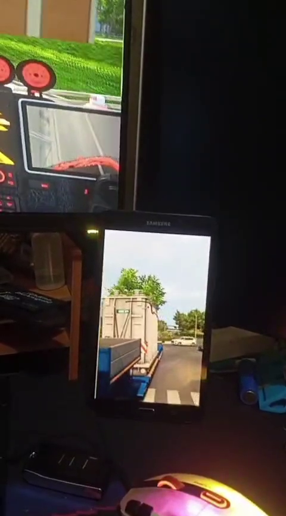
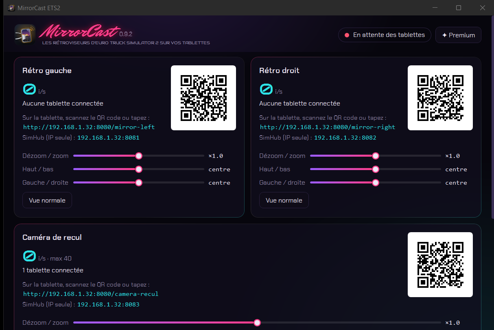
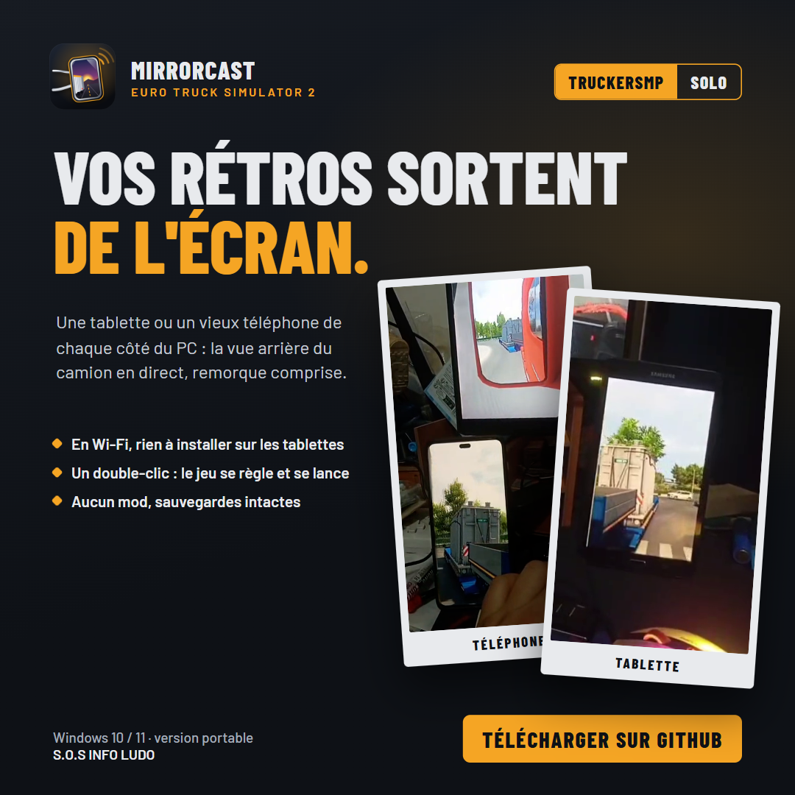

### Les rétroviseurs d'Euro Truck Simulator 2 sur vos tablettes.

*Posez une tablette de chaque côté de votre écran : elles affichent en direct ce que voient les rétroviseurs de votre camion, remorque comprise, en Wi‑Fi et sans rien installer dessus. Une troisième peut servir de **GPS**, qui laisse place à la **caméra de recul** dès que vous reculez.*

 

 

<i>En jeu : en haut le rétroviseur dans ETS2, en bas le téléphone qui sert de rétro, remorque comprise.</i>

  

[**Pourquoi**](#-pourquoi-mirrorcast-) · [**Fonctionnalités**](#-fonctionnalités) · [**En images**](#%EF%B8%8F-en-images) · [**Gratuit ou Premium**](#-gratuit-ou-premium-) · [**Télécharger**](#%EF%B8%8F-télécharger) · [**Questions fréquentes**](#-questions-fréquentes)

 

---

## 💡 Pourquoi MirrorCast ?

Dans ETS2, les rétroviseurs sont petits, coincés dans un coin de l'écran, et il faut tourner
la tête virtuelle pour bien voir la remorque. Dans un vrai camion, ils sont **sur les côtés**.

**MirrorCast remet les rétros à leur place.** Une tablette (ou un vieux téléphone) à gauche, une
autre à droite : chacune affiche en continu la vue arrière de son côté. Votre écran garde la
vue cabine, sans rien qui la gêne.

 

## ✨ Fonctionnalités

<table>
<tr>
<td width="50%" valign="top">

### 🪞 De vrais rétroviseurs
- **Vue arrière gauche et droite**, avec la **remorque visible**.
- Image **inversée comme dans un miroir**.
- Angles des rétros **réglables** (direction, zoom, position).
- En **multijoueur TruckersMP** comme en **solo**.
- Environ **24 images par seconde** en jeu, avec une latence d'environ **25 ms** sur la mire.

</td>
<td width="50%" valign="top">

### 📱 Rien à installer sur les tablettes
- Une **simple page web** : Chrome ou Safari suffisent.
- Fonctionne avec de **vieilles tablettes** (testé sur Android 7).
- **Reconnexion automatique** en cas de coupure Wi‑Fi.
- Plein écran, ajustement de l'image, inversion d'un toucher.
- Compatible **SimHub** (✦ Premium) : chaque rétro a sa propre adresse IP + port.
- 🆕 **Zoom et dézoom depuis le PC** (✦ Premium) : le curseur de chaque rétro part du milieu (vue normale), dézoome à gauche, zoome à droite ; le rétro se vise aussi vers le haut, le bas, la gauche ou la droite, en direct.

</td>
</tr>
<tr>
<td width="50%" valign="top">

### 🆕 Caméra de recul et GPS
- Une **3e tablette** affiche le **GPS** ([TruckNav](https://github.com/Rares-Muntean/TruckNav-Sim)) pendant que vous roulez.
- Dès que vous passez la **marche arrière**, elle bascule **instantanément** sur la **caméra de recul**, puis revient au GPS : l'itinéraire est conservé.
- Une caméra **sans remorque** et une **avec remorque** : la bonne s'affiche toute seule.
- Le GPS est **intégré à MirrorCast** : rien d'autre à installer ni à ouvrir.

</td>
<td width="50%" valign="top">

### 🚀 Plus fluide
- 🆕 Les tablettes et téléphones **ne gèlent plus** quand on monte les images par seconde : le PC n'envoie jamais plus d'images que l'appareil n'en affiche.

</td>
</tr>
<tr>
<td width="50%" valign="top">

### 🧩 Tout-en-un
- **Un double-clic** sur `MirrorCast.exe` :
- il **règle ETS2** (mode multi-écran, vues des rétros, fenêtre) ;
- vous choisissez **TruckersMP ou Solo** : il **lance le jeu** et **place sa fenêtre** ;
- sa **fenêtre** affiche un **QR code** par rétro : la tablette le scanne, c'est tout.

</td>
<td width="50%" valign="top">

### 🎮 Respecte le jeu et le PC
- **Rien n'est injecté** dans ETS2 : aucun mod, aucun risque pour vos sauvegardes.
- Votre écran n'est **jamais lu** : seules les vues des rétros sont capturées.
- **Aucune capture** tant qu'aucune tablette n'est connectée.
- **« Tout annuler »** remet ETS2 et Windows comme avant.

</td>
</tr>
</table>

 

## 🖼️ En images

<table>
<tr>
<td width="50%" align="center">
 
<b>Le rétro sur le téléphone</b> La remorque, comme dans le rétroviseur du jeu.
</td>
<td width="50%" align="center">
 
<b>Sur une tablette</b> Une vieille tablette Samsung sous l'écran : la remorque en direct.
</td>
</tr>
<tr>
<td colspan="2" align="center">
 
<b>La fenêtre du PC</b> TruckersMP ou Solo en un clic, images par seconde de chaque rétro, tablettes connectées et QR code à scanner.
</td>
</tr>
</table>

 

 

## 💎 Gratuit ou Premium ?

MirrorCast s'utilise **gratuitement**, sans limite de temps : vos deux rétros sur tablettes, tout de suite. La version **Premium** ajoute le réglage en direct de chaque rétro et la compatibilité SimHub, **à vie** sur votre ordinateur, pour **15 €** en une seule fois : pas d'abonnement.

| | Gratuit | ✦ Premium · 15 € à vie |
|---|:---:|:---:|
| Les deux rétros sur tablettes ou téléphones, en Wi‑Fi | ✅ | ✅ |
| 🆕 Caméra de recul et GPS intégré | ✅ | ✅ |
| Réglage automatique d'ETS2, lancement Solo ou TruckersMP | ✅ | ✅ |
| QR codes, mire de test, « Tout annuler » | ✅ | ✅ |
| Zoom, dézoom et visée de chaque rétro en direct, depuis le PC | — | ✅ |
| Compatibilité SimHub (une adresse IP + port par rétro) | — | ✅ |

### Obtenir Premium · 15 €

1. Dans MirrorCast, cliquez sur **Passer Premium** (en haut à droite), puis sur **Copier** à côté de votre **code machine**.
2. Envoyez ce code à **S.O.S INFO LUDO** : ✉️ **s.o.sinfoludo@gmail.com** · 📞 **06 59 59 05 15** · 💬 **[Discord](https://discord.gg/W5hd36CW6b)**.
3. Réglez **15 €** par **carte bancaire**, par **virement**, ou en **espèces** à l'atelier de Boulogne-sur-Mer.
4. Vous recevez votre licence par e-mail : collez-la dans la fenêtre **Licence** (ou ouvrez le fichier `.lic`), cliquez sur **Activer Premium**, puis sur **Redémarrer MirrorCast**.

> La licence est vérifiée **sur votre PC, sans connexion Internet**, et reste valable à vie sur cet ordinateur. Micro-entreprise : TVA non applicable, article 293 B du CGI.

 

## ⬇️ Télécharger

### [**➜ Page de téléchargement (dernière version)**](https://github.com/lerapeurdu62280-debug/MirrorCast-ETS2-Download/releases/latest)

| Fichier | Contenu |
|---|---|
| **`MirrorCast-ETS2-v0.7.1.zip`** | Version portable, GPS inclus : décompressez-la où vous voulez, il n'y a rien à installer. |

> **Windows affiche « Windows a protégé votre ordinateur » ?** C'est normal pour un logiciel récent. Cliquez sur **Informations complémentaires**, puis sur **Exécuter quand même**.

### 🖥️ Configuration requise
- **Windows 10 ou 11**, 64 bits, et **Euro Truck Simulator 2** sur Steam (avec ou sans **TruckersMP**).
- Une carte graphique de jeu (testé avec une **RTX 3050**).
- Deux ou trois **tablettes ou téléphones** avec un navigateur, sur le **même réseau Wi‑Fi** que le PC (5 GHz conseillé).
- Le pilote gratuit **[Virtual Display Driver](https://github.com/VirtualDrivers/Virtual-Display-Driver/releases)**, qui crée les écrans invisibles où le jeu dessine les rétros (et la caméra de recul).

 

## 🚀 En trois gestes

1. **Une seule fois :** installez Virtual Display Driver et créez **deux écrans de 400×720**, collés à gauche et à droite de votre écran dans *Paramètres → Affichage*. Le fichier `LISEZMOI.txt` vous guide.
2. **Double-cliquez sur `MirrorCast.exe`**, puis cliquez sur **TruckersMP** ou **Solo** dans sa fenêtre. Au premier lancement, autorisez-le dans le pare-feu Windows.
3. **Sur chaque tablette**, scannez le QR code du rétro (ou tapez l'adresse affichée dessous). C'est prêt.

**Caméra de recul et GPS (facultatif) :** créez deux écrans de plus, de **400×360**, collés **sous** chaque écran de rétro, relancez MirrorCast jeu fermé, puis scannez le QR code **« Caméra de recul »** avec la 3e tablette. Au premier lancement, Windows peut demander d'autoriser « TruckNavTelemetry » dans le pare-feu : acceptez.

 

## 🧭 Où en est le projet ?

| Étape | État |
|---|---|
| Rétros en jeu sur tablettes, remorque visible, ~24 i/s | ✅ Testé en conditions réelles |
| Mire de test, fenêtre du PC avec QR codes (version 0.4.0) | ✅ Testés |
| Mode tout-en-un (réglage et lancement automatiques d'ETS2) | ✅ Testé en conditions réelles |
| Multijoueur TruckersMP (bouton de la fenêtre, jeu en ligne) | ✅ Testé en conditions réelles |
| Compatibilité SimHub (adresse IP + port, plein cadre) | ✅ Testé en conditions réelles |
| 🆕 Zoom (version 0.5.0) | ✅ Testé en conditions réelles |
| 🆕 Dézoom et visée sans zoomer (version 0.5.1) | ✅ Testé en conditions réelles |
| 🆕 Dézoom deux fois plus large (version 0.5.2) | ✅ Testé en conditions réelles |
| Version gratuite et Premium (version 0.6.0) | ✅ Testées sur PC |
| 🆕 Caméra de recul et GPS intégré (versions 0.7.0 et 0.7.1) | 🔶 Testés sur PC avec la mire, essai en jeu à venir |
| 🆕 Fin des gels sur tablettes et téléphones (version 0.7.0) | 🔶 Testé sur PC, essai sur iPhone et Samsung à venir |

 

## ❓ Questions fréquentes

<b>Est-ce que ça modifie le jeu ou mes sauvegardes ?</b>

 
Non. MirrorCast n'installe aucun mod et ne touche pas à vos profils. Il règle seulement l'affichage d'ETS2 (mode multi-écran et vues des rétros), après avoir sauvegardé vos fichiers de configuration. « Tout annuler » les remet tels qu'ils étaient.

<b>Pourquoi faut-il des écrans virtuels ?</b>

 
ETS2 sait dessiner plusieurs vues à la fois, mais seulement sur des écrans. Les écrans virtuels sont invisibles et branchés à rien : le jeu y dessine les rétros, et MirrorCast les envoie aux tablettes. Votre écran à vous ne change pas.

<b>Les rétros se figent quand je reviens dans le jeu.</b>

 
Quittez ETS2 et relancez-le : le réglage anti-gel appliqué par MirrorCast n'est pris en compte qu'au démarrage du jeu. La fenêtre de MirrorCast vous prévient si cela arrive.

<b>La tablette ne se connecte pas.</b>

 
Vérifiez que le PC et la tablette sont sur le même réseau, et que MirrorCast est autorisé dans le pare-feu Windows (réseau privé). Avec un VPN sur le PC, activez l'option de visibilité du réseau local. La mire de test permet de vérifier tout cela sans lancer le jeu.

<b>Ça marche sur TruckersMP ?</b>

 
Oui. Cliquez sur « TruckersMP » dans la fenêtre de MirrorCast : MirrorCast ouvre le launcher TruckersMP, vous cliquez sur « Launch », et le jeu est réglé et capturé de la même façon qu'en solo. MirrorCast n'est pas un mod : il ne touche pas au jeu, il capture seulement les vues des rétros affichées par Windows. Raccourci direct : <code>Lancer TruckersMP.bat</code>.

<b>Ça marche avec SimHub ?</b>

 
Oui, avec la version Premium. SimHub n'accepte qu'une adresse IP et un port : chaque rétro a donc aussi son propre port, affiché sous son QR code dans la fenêtre de MirrorCast. Par exemple <code>192.168.1.20:8081</code> pour le rétro gauche et <code>192.168.1.20:8082</code> pour le droit. Par ces adresses, l'image remplit toute la zone de SimHub, sans bandes noires.

<b>Comment marche la caméra de recul ?</b>

 
ETS2 dessine deux vues de plus, vers l'arrière du camion : une pour reculer sans remorque, une pour reculer avec. MirrorCast lit le rapport engagé grâce au GPS intégré : en marche arrière, la 3e tablette passe du GPS à la bonne caméra, puis y revient. Les angles se règlent dans <code>mirrorcast.json</code>, comme ceux des rétros.

<b>Faut-il installer TruckNav ?</b>

 
Non. Le GPS TruckNav est livré dans le dossier de MirrorCast, qui l'affiche et le démarre lui-même, sans fenêtre. Il s'arrête quand vous fermez MirrorCast.

<b>Ça marche avec American Truck Simulator ?</b>

 
Pas encore : cette version ne gère qu'Euro Truck Simulator 2.

 

---

💬 Une question, un souci ? Rejoignez le **[Discord de l'atelier](https://discord.gg/W5hd36CW6b)**.

**MirrorCast ETS2** — conçu et développé par **S.O.S INFO LUDO**

Logiciel propriétaire, tous droits réservés. GPS : <a href="https://github.com/Rares-Muntean/TruckNav-Sim">TruckNav</a> par Rares Muntean, logiciel libre sous licence GPL-3.0, livré non modifié dans le dossier <code>trucknav</code> avec sa licence. Euro Truck Simulator 2 est une marque de SCS Software. Ce logiciel est indépendant : il n'est ni affilié à SCS Software, ni approuvé par SCS Software.

